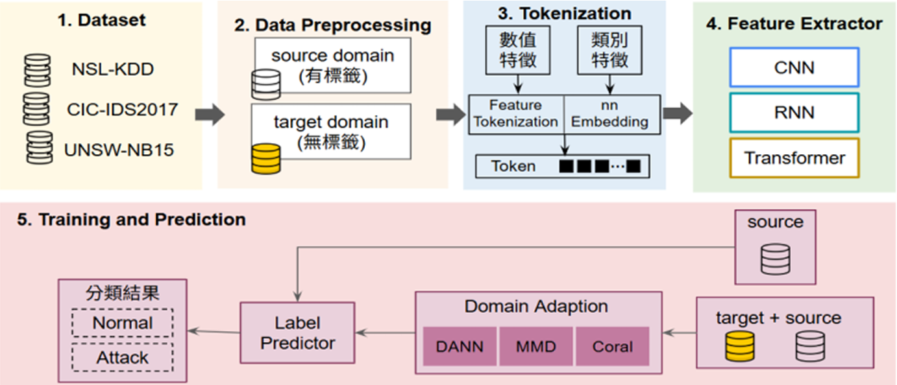

# 領域適應方法於網路入侵偵測模型泛化能力之比較研究

*A Comparative Study of Domain Adaptation Methods for Generalizable Network Intrusion Detection Models*

> 本儲存庫提供本研究的實驗程式，整合 CNN、RNN、Transformer 與 DANN、MMD、Deep CORAL，並以 Source-only 作為比較基準。
> 實驗設定與方法實作說明請參閱 [Paper Alignment Notes](docs/paper_alignment.md)。

## Authors

| Name | Affiliation | Email |
| --- | --- | --- |
| 陳韋廷 | 國立臺灣科技大學電機工程學系 | B11307127@mail.ntust.edu.tw |
| 楊忠穎 | 國立臺灣科技大學電機工程學系 | B11307135@mail.ntust.edu.tw |
| 楊晴安 | 國立臺灣科技大學電機工程學系 | yang81.yang2003@gmail.com |
| 黃意婷 | 國立臺灣科技大學電機工程學系 | ythuang@mail.ntust.edu.tw |

## Abstract

網路入侵偵測模型在實際部署時，常因訓練與測試資料的攻擊組成及特徵分布不同而降低偵測能力。本研究使用 NSL-KDD、CICIDS2017 與 UNSW-NB15 三個公開資料集，分別建立 source domain 與 target domain，探討不同領域適應方法對二元入侵偵測模型泛化能力的影響。

研究採用 Feature Tokenization，將數值與類別特徵轉換為 token sequence，再以 CNN、RNN 或 Transformer 提取特徵。除 Source-only baseline 外，比較透過領域對抗訓練的 Domain-Adversarial Neural Network（DANN）、以核函數衡量分布差異的 Maximum Mean Discrepancy（MMD），以及對齊特徵協方差的 Deep Correlation Alignment（Deep CORAL）。訓練時使用 source domain 的標籤計算分類損失，並利用未標註的 target domain 特徵進行領域適應，最後評估模型在 target domain 上辨識正常流量與攻擊流量的能力。

**Keywords:** Intrusion Detection System, Domain Adaptation, Feature Tokenization, DANN, MMD, Deep CORAL.

## System Flowchart

<p align="center">
  
</p>

系統流程包含資料集準備、source/target domain 前處理、Feature Tokenization、特徵提取，以及領域適應與二元分類。Source-only 僅以 source domain 訓練；DANN、MMD 與 Deep CORAL 則同時利用 source 與 target 特徵進行適應，target 標籤僅供評估使用。

## Conclusion

根據論文實驗結果，最佳特徵提取器與領域適應方法會隨資料集的攻擊組成及分布差異而改變。在 NSL-KDD 中，RNN-MMD 表現最佳；在 source 與 target 攻擊組成差異較大的 CICIDS2017 中，RNN-DANN 的效果最突出；在兩個 domain 攻擊種類相同的 UNSW-NB15 中，Source-only 已有良好表現，CNN-CORAL 則帶來小幅改善。

整體而言，RNN 在本研究的三個資料集上呈現較穩定的泛化表現。DANN 與 MMD 在部分領域位移設定下能改善偵測能力，但不保證在所有資料集上優於 Source-only；Deep CORAL 的協方差對齊方式較為輕量，在分布差異較小的設定下具有穩定性。因此，領域適應策略應配合資料集特性選擇，並同時考量 Accuracy、Precision、Recall、F1-score 與訓練成本。

## Acknowledgments

本研究成果承蒙國家科學及技術委員會研究計畫支持，詳細計畫資訊請參閱論文定稿之致謝。

## Reproducibility

### 實驗設計

| 項目 | 設定 |
| --- | --- |
| 資料集 | NSL-KDD、CICIDS2017、UNSW-NB15 |
| 特徵提取器 | CNN、RNN、Transformer |
| 訓練策略 | Source-only、DANN、MMD、Deep CORAL |
| 分類任務 | Normal = 0，Attack/Anomaly = 1 |
| 分類損失 | BCEWithLogitsLoss |
| 優化器 | AdamW，learning rate = `1e-3`，weight decay = `1e-4` |
| 訓練批次 | batch size = `256`，每個 epoch 最多 `200` batches |
| 訓練回合 | `30` epochs |
| 類別不平衡處理 | Source class-balanced sampling，攻擊類別損失權重為 `2.0` |

### 專案目錄

```text
domain_adaptation_ids_github/
  README.md
  notebooks/
    CNN_RNN_TRA_NSL_KDD_DANN_MMD_CORAL.ipynb
    CNN_RNN_TRA_CICIDS_2017_DANN_MMD_CORAL.ipynb
    CNN_RNN_TRA_UNSW_NB15_DANN_MMD_CORAL.ipynb
  docs/
    paper_alignment.md
    images/
      system-flowchart.png
  requirements.txt
  .gitignore
```

### 資料集放置位置

資料集檔案通常較大，已由 `.gitignore` 排除。請在 repo 根目錄建立 `data/`，並依下列結構放置原始資料：

```text
data/
  NSL_KDD/
    KDDTrain+.arff
    KDDTest+.arff
  CICIDS_2017/
    Monday-WorkingHours.pcap_ISCX.csv
    Tuesday-WorkingHours.pcap_ISCX.csv
    Wednesday-workingHours.pcap_ISCX.csv
    Thursday-WorkingHours-Morning-WebAttacks.pcap_ISCX.csv
    Thursday-WorkingHours-Afternoon-Infilteration.pcap_ISCX.csv
    Friday-WorkingHours-Morning.pcap_ISCX.csv
    Friday-WorkingHours-Afternoon-DDos.pcap_ISCX.csv
    Friday-WorkingHours-Afternoon-PortScan.pcap_ISCX.csv
  UNSW_NB15/
    UNSW_NB15_training-set.csv
    UNSW_NB15_testing-set.csv
```

### 使用方式

1. 建立 Python 環境。
2. 安裝套件：

```bash
pip install -r requirements.txt
```

3. 從 repo 根目錄啟動 Jupyter：

```bash
jupyter lab
```

4. 開啟對應資料集的 notebook，確認 `Config` 中的資料路徑，再由上到下執行資料讀取、前處理、Source-only、DANN、MMD 與 CORAL 的訓練及評估 cells。

| 資料集 | Notebook |
| --- | --- |
| NSL-KDD | [CNN_RNN_TRA_NSL_KDD_DANN_MMD_CORAL.ipynb](notebooks/CNN_RNN_TRA_NSL_KDD_DANN_MMD_CORAL.ipynb) |
| CICIDS2017 | [CNN_RNN_TRA_CICIDS_2017_DANN_MMD_CORAL.ipynb](notebooks/CNN_RNN_TRA_CICIDS_2017_DANN_MMD_CORAL.ipynb) |
| UNSW-NB15 | [CNN_RNN_TRA_UNSW_NB15_DANN_MMD_CORAL.ipynb](notebooks/CNN_RNN_TRA_UNSW_NB15_DANN_MMD_CORAL.ipynb) |

資料路徑以 notebook 核心目前的工作目錄為準。如果核心在 `notebooks/` 中執行，請將 `Config` 的 `data_dir`、`source_path` 或 `target_path` 改為對應的 `../data/...` 路徑。

### 備註

- 預設每個 epoch 訓練 200 batches。
